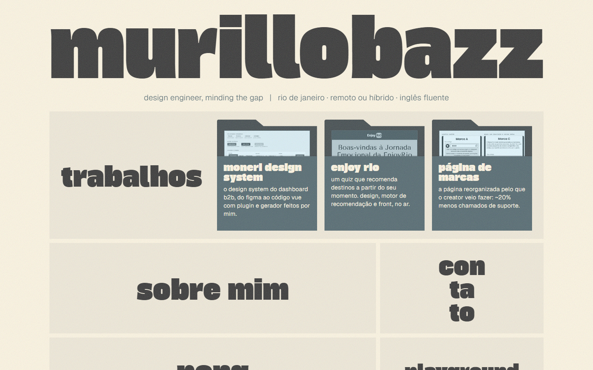

# murillobazz.com

My portfolio as a design engineer: three case studies, a playground and a site that is a small case study itself. Designed and built by hand, no template and no UI library.

**→ [murillobazz.com](https://murillobazz.com)**



## The cases

- **[Moneri design system](https://murillobazz.com/work/design-system)**: a design system for a B2B dashboard, extracted from production code, rebuilt in Figma with variables and synced back into Vue by a Figma plugin and a code generator I wrote.
- **[Enjoy Rio](https://murillobazz.com/work/enjoy-rio)**: a quiz that recommends trips in Rio de Janeiro state based on how you feel. Design, recommendation engine and front end, live.
- **[Brand page](https://murillobazz.com/work/marcas)**: a creator platform page reorganized around what creators came to do, with ~20% fewer support tickets.

## Decisions worth a look

- **The whole site runs on a handful of CSS variables.** Each of the five color schemes is the same six tokens with different values. The playground's *break my site* hands those tokens to the visitor (hover and border colors follow along) with a contrast police that flags every text pair below 4.5:1.
- **Titles are SVG text stretched to the full width.** On the home page the title sticks and stretches upward as you scroll; on inner pages it's squashed to save vertical space and only the nav sticks.
- **"minding the gap"**: the tagline opens like subway doors to reveal *design ↔ code*. Until the first interaction it twitches and plays the door chime as a hint, then remembers you found it.
- **Case studies are data.** Each case is a list of typed blocks (text, image, callout, stats, code) in `src/utils/cases.js`, in Portuguese and English, rendered by a single page component.
- **Accessibility as a constraint, not a pass.** Text pairs are checked against 4.5:1, `prefers-reduced-motion` turns the animations off, and the tagline's doors also open on keyboard focus.

## Stack

React 19, React Router 7 (with view transitions between the work list and each case) and Vite. Plain CSS, no framework. Deployed on Vercel.

## Running it

```bash
pnpm install
pnpm dev
```

`pnpm lint` and `pnpm build` are what I run before every push.

```
src/
  pages/        one component per route
  components/   the title, nav, tagline, pong, playground pieces
  utils/        translations, case studies, contrast math
public/         case study images (client data anonymized)
```
